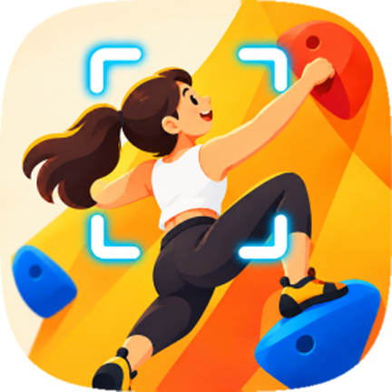
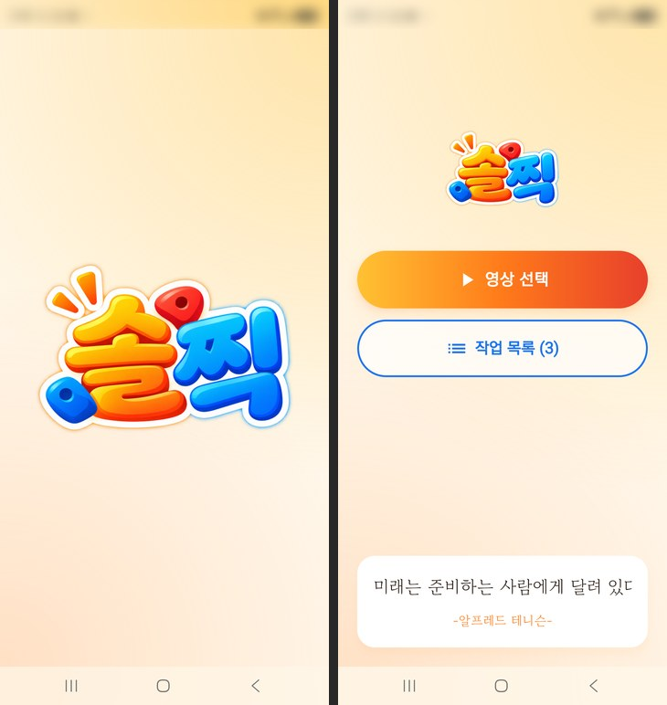
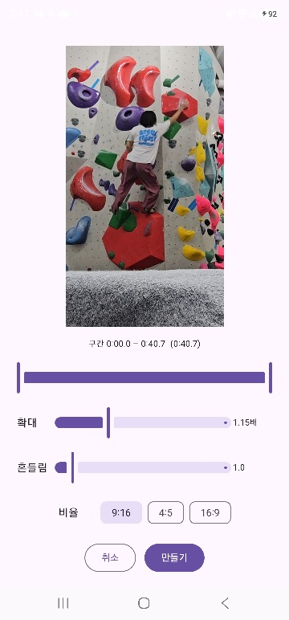
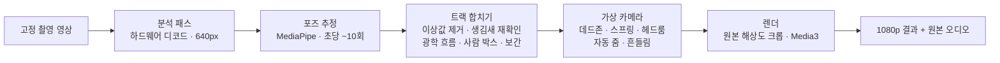
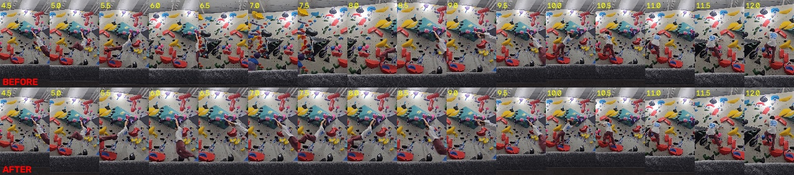
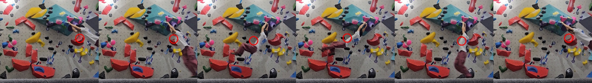
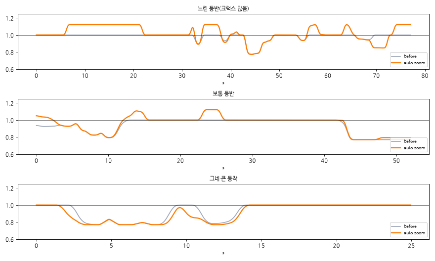

<p align="center">
  
</p>

<h3 align="center">솔로로 들고 찍는다 — 혼자 찍은 등반 영상을, 누가 옆에서 들고 따라 찍어준 것처럼</h3>

<p align="center">
  <a href="https://github.com/stPark-dev/solzzick/releases/latest"></a>
</p>

<p align="center">
  
  
  
  
</p>

---



혼자 클라이밍장에 가면 삼각대나 바닥에 폰을 세워 두고 벽 전체가 나오게 **고정 촬영**할 수밖에 없습니다. 그러면 등반자는 작게 나오고, 화면은 내내 정지해 있어서 SNS에 올리기도, 자기 동작을 돌아보기도 어렵습니다.

**솔찍**은 그 고정 영상에서 등반자를 자동으로 찾아 따라가며, 사람이 폰을 들고 따라 찍은 듯한 세로 영상을 만들어 줍니다. 분석부터 인코딩까지 **모두 폰 안에서** 처리하고, 영상은 기기 밖으로 나가지 않습니다.

<br clear="left">

## 미리 보기

<p align="center">
  
  &nbsp;&nbsp;
  
</p>
<p align="center"><sub>스플래시 → 오늘의 명언이 있는 첫 화면 → 실시간 미리보기 편집 화면</sub></p>

## 주요 기능

| | |
|---|---|
| 🎯 **등반자 자동 추적** | 포즈 추정으로 등반자의 몸통·팔다리를 프레임마다 찾습니다. 벽에 여러 명이 있으면 첫 장면에서 탭으로 고르세요. |
| 🎥 **사람이 든 것 같은 카메라** | 데드존·반응 지연·스프링 추종·헤드룸, 그리고 저주파 프레이밍 흔들림과 손떨림(회전 포함)을 더합니다. 흔들림 0이면 짐벌 느낌. |
| 🔍 **자동 줌** | 손발이 잘리지 않게 미리 줌아웃하고, 한자리에 오래 머무는 크럭스는 조금 가까이, 다이노·추락 같은 큰 동작은 넓게 잡습니다. |
| ✂️ **자동 트리밍** | 등반자가 보이는 구간만 자동으로 골라 주고, 타임라인 손잡이로 앞뒤를 다듬을 수 있습니다. |
| 🎚️ **실시간 미리보기 & 조절** | 다시 인코딩하지 않고 결과 그대로 미리 봅니다. 탐색 막대로 원하는 순간으로 바로 이동. 확대 1.0~1.5배, 흔들림 짐벌~10, 비율 9:16 · 4:5 · 16:9. |
| 🏷️ **영상에 표시** | 결과 영상 왼쪽 아래에 난이도(색깔 하트 ❤️🧡💛💚🩵💙💜🩷🤎🩶🖤🤍)·암장 이름·촬영 날짜를 작게 넣습니다. 모두 선택 사항, 암장 이름은 기억합니다. |
| 📚 **일괄 편집** | 여러 영상을 골라 두면 백그라운드에서 차례로 분석합니다. 공통 설정을 주고, 손볼 영상만 열어 고친 뒤 한 번에 만듭니다. 앱을 껐다 켜도 목록이 남아 이어서 처리합니다. |
| 💾 **분석 결과 기억** | 한 번 분석한 영상은 다시 열면 바로 편집 화면으로 갑니다. 설정만 바꿔 다시 만들 때 기다리지 않습니다. 엉뚱한 사람을 따라갔다면 "다시 분석". |
| 📤 **공유로 열기** | 갤러리·카톡에서 영상을 "공유 → 솔찍". 하나면 편집, 여러 개면 일괄 편집으로 바로 열립니다. |
| 🔒 **온디바이스** | 서버 없이 폰에서 처리합니다. 네트워크는 첫 화면 명언을 받을 때만 씁니다(실패하면 내장 명언). |

## 설치

1. [**Releases**](https://github.com/stPark-dev/solzzick/releases/latest)에서 `solzzick-x.y.z.apk`를 내려받습니다.
2. 파일을 열고 "출처를 알 수 없는 앱 설치"를 허용한 뒤 설치합니다.
3. Play 프로텍트 경고가 뜨면 "무시하고 설치"를 누르세요(스토어 밖 앱이라 뜨는 일반 경고입니다).
4. 0.3.0 이하가 깔려 있다면 먼저 삭제한 뒤 설치하세요 — 0.3.1부터 서명 키가 바뀌어 덮어 설치가 되지 않습니다.

> 64비트 ARM(arm64) Android 10 이상. 결과물은 갤러리 `Movies/솔찍`에 저장됩니다.
> 화질은 원본이 좋을수록 좋습니다 — 가능하면 **카메라 원본(UHD·60fps)** 으로 찍은 영상을 쓰세요.
> 결과물은 원본과 같은 프레임레이트로 나옵니다(60fps 원본 → 60fps). 원본이 저해상도이거나 카톡 등으로 다시 압축된 영상이면 편집 화면에서 알려 줍니다.

## 어떻게 동작하나



### 1. 실제 '들고 찍은' 영상에서 배운 카메라

사람이 들고 찍은 클라이밍 영상을 분석해(배경 특징점으로 카메라 궤적을 복원하고, 등반자 위치와 비교) 가상 카메라의 기본값을 정했습니다.

| 항목 | 측정 | 기본값 |
|---|---|---|
| 몸 크기(화면 높이 대비) | 22% | 넓은 샷 |
| 세로 데드존 | ±20% | ±18% |
| 가로 반응 | 지연 0.2초 이하 · 오버슈트 없음 | ω 8, ζ 0.9, 지연 0.1초 |
| 느린 프레이밍 흔들림 | 4~6%, 약 0.1Hz | 3% / 2% |
| 손떨림 | 0.07%, 회전 0.017° | 슬라이더 1배 |

사람 손맛의 핵심은 '늦게 따라가기'가 아니라 **세로 데드존과 느린 프레이밍 흔들림**이었습니다.

### 2. 놓치지 않는 추적

포즈 모델은 빠른 동작·흐린 자세에서 자주 놓치고, 가끔은 홀드를 사람으로 착각합니다. 솔찍은 이렇게 버팁니다.

- **짧게 튄 가짜 포즈 제거** — 앞뒤 움직임에 맞춘 직선에서 혼자 벗어나거나, 앞뒤 위치는 같은데 혼자만 먼 '왕복' 값은 버립니다. 실제 다이노·추락(편도)은 남깁니다.
- **생김새로 다시 확인** — 공백 뒤 먼 곳에서 다시 잡힌 사람은 몸통 색 분포가 등반자와 비슷할 때만 받아들입니다.
- **광학 흐름으로 공백 메우기** — 포즈가 비는 동안 몸 위의 특징점을 피라미드 Lucas–Kanade로 매 프레임 따라갑니다(순수 Kotlin 구현, OpenCV와 점별 차이 0.5px 이하). 다음 포즈와 맞물리게 끝에서 보정합니다.

<p align="center">
  
</p>
<p align="center"><sub>그네 동작 중 홀드를 사람으로 착각해 카메라가 엉뚱하게 가던 문제(위) → 수정 후(아래)</sub></p>

<p align="center">
  
</p>
<p align="center"><sub>포즈 모델이 하나도 못 잡은 매달림·스윙 구간에서도 광학 흐름(빨간 원)은 몸을 따라갑니다</sub></p>

가린 구간 검증(실제 포즈가 있는 구간을 일부러 지우고 채운 뒤 비교)에서 광학 흐름은 단순 보간보다 오차가 **34% 작고**, 빠른 그네 동작에서는 **60% 작습니다**.

### 3. 동작을 읽는 자동 줌

<p align="center">
  
</p>
<p align="center"><sub>1보다 크면 가까이, 작으면 넓게. 크럭스는 3초 이상 이어질 때만 가까이 — 줌이 숨쉬듯 들썩이지 않게</sub></p>

## 프로젝트 구조

```
android/
  core/        순수 Kotlin(안드로이드 의존 없음) — 가상 카메라, 트랙 합치기, 광학 흐름, 자동 트리밍, 일괄 편집 큐
  app/         안드로이드 앱 — GPU 디코더, MediaPipe 연결, Media3 렌더, Compose UI, 포그라운드 서비스
prototype/     Python 기준 구현 — 레퍼런스 분석, 알고리즘 실험·튜닝, Kotlin 검증용 기준 데이터(golden) 생성
docs/images/   README 이미지
```

`core`의 알고리즘은 Python 기준 구현과 **같은 입력에서 같은 출력**(오차 1e-6px 이내)을 내는지 실제 등반 영상 데이터로 검증합니다.

## 개발

```bash
# Android (JDK 17+)
cd android
./gradlew :core:test                 # 순수 Kotlin 테스트(JVM)
./gradlew :app:assembleDebug         # 디버그 APK
# 실기기 테스트(분석·렌더·일괄 편집·UI). 디버그 빌드는 com.zzick.debug라 정식판과 같이 깔린다.
# connectedAndroidTest는 끝나면 앱을 지워 테스트 영상도 사라지므로, 설치 후 직접 실행한다:
./gradlew :app:installDebug :app:installDebugAndroidTest
adb shell am instrument -w com.zzick.debug.test/androidx.test.runner.AndroidJUnitRunner
# 실기기 테스트용 영상은 저장소에 없음 — 앱 내부 저장소(files/videos/)에 넣어 둔다:
#   adb push <영상> /sdcard/Android/data/com.zzick.debug/files/videos/
#   adb shell run-as com.zzick.debug cp /storage/emulated/0/Android/data/com.zzick.debug/files/videos/<영상> files/videos/
# 60fps·UHD·저화질 영상은 20260927_113733.mp4에서 만든다:
#   ffmpeg -t 12 -i 20260927_113733.mp4 -vf minterpolate=fps=60:mi_mode=blend -c:v libx265 -b:v 20M -tag:v hvc1 -c:a aac fps60.mp4
#   ffmpeg -t 10 -i 20260927_113733.mp4 -vf "scale=2160:2160,pad=2160:3840:0:840,minterpolate=fps=60:mi_mode=blend" -c:v libx265 -b:v 45M -tag:v hvc1 -c:a aac uhd60.mp4
#   ffmpeg -t 10 -i 20260927_113733.mp4 -vf scale=720:720 -c:v libx264 -b:v 1500k -maxrate 1500k -bufsize 3M -c:a aac kakao.mp4

# Python 프로토타입
cd prototype
python3 -m venv .venv && .venv/bin/pip install numpy opencv-python-headless scipy mediapipe matplotlib pytest
./download_models.sh
.venv/bin/pytest -q
```

| 테스트 | 개수 |
|---|---|
| Python(기준 구현) | 78 |
| Kotlin JVM(`core`) | 97 |
| 실기기(Galaxy S23 Ultra) | 58 |

모든 기능은 테스트를 먼저 쓰고(실패 확인) 구현했습니다.

### 배포

서명은 GitHub Actions가 합니다(키는 저장소 Secrets에만 있음). `android/app/build.gradle.kts`의 `versionCode`·`versionName`을 올려 커밋한 뒤:

```bash
git tag v0.3.2 && git push origin main --tags   # 테스트 → 서명 빌드 → Releases에 APK 첨부
```

태그와 `versionName`이 다르면 빌드가 멈춥니다. Actions 탭의 **release → Run workflow**로 돌리면 릴리스 없이 서명된 APK만 받아 볼 수 있습니다.

## 알려진 한계

- 원본 영상에서 잘라 확대하므로, 1080p 원본은 확대할수록 부드러워집니다. 4K 원본을 권장합니다.
- 다른 앱에서 공유로 받은 영상은 그 앱이 준 읽기 권한이 앱 종료 뒤 사라질 수 있습니다. 일괄 편집 중 앱이 꺼졌다면 그 영상만 다시 공유해 주세요(앱에서 직접 고른 영상은 괜찮습니다).
- MediaPipe 네이티브 라이브러리가 16KB 메모리 페이지에 정렬돼 있지 않아, 16KB 페이지를 쓰는 일부 최신 기기에서는 실행되지 않을 수 있습니다.

## 사용한 것들

- [MediaPipe](https://github.com/google-ai-edge/mediapipe) Pose Landmarker · Object Detector — Apache 2.0
- [AndroidX Media3](https://github.com/androidx/media) Transformer · ExoPlayer — Apache 2.0
- [나눔손글씨 붓](https://github.com/google/fonts/tree/main/ofl/nanumbrushscript) — SIL Open Font License 1.1 ([전문](android/licenses/NanumBrushScript-OFL.txt))
- [korean-advice-open-api](https://github.com/gwongibeom/korean-advice-open-api) — 첫 화면 랜덤 명언
